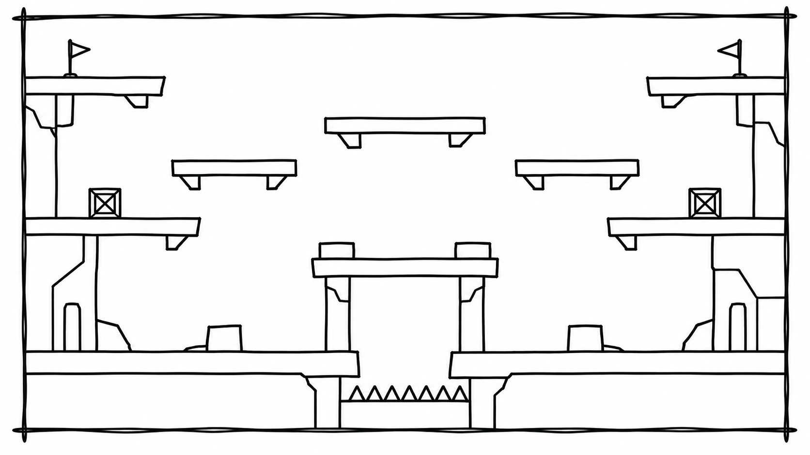
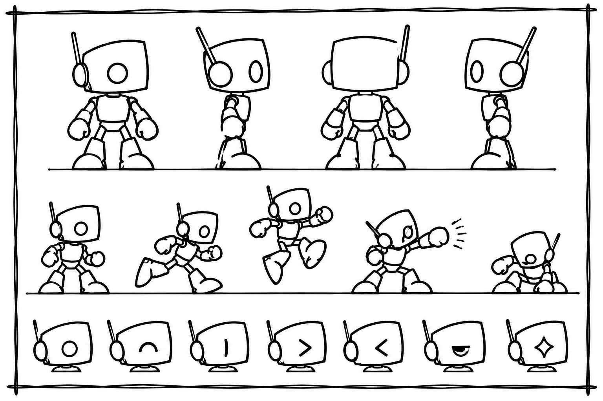
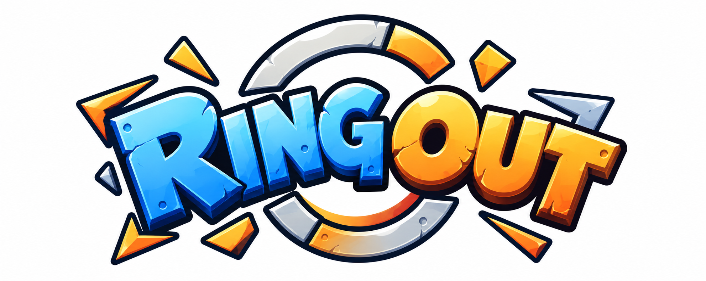
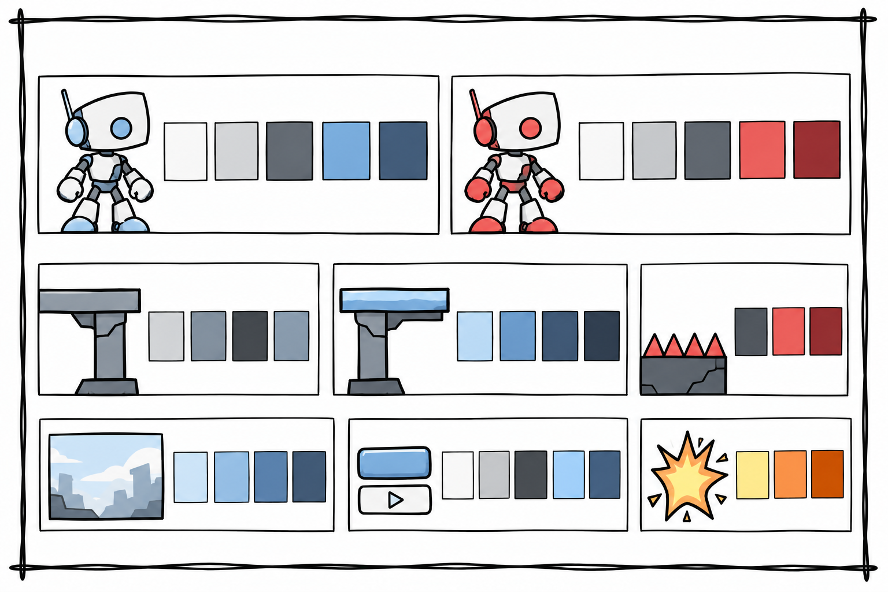
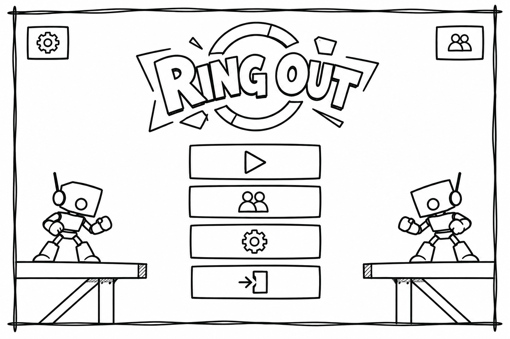
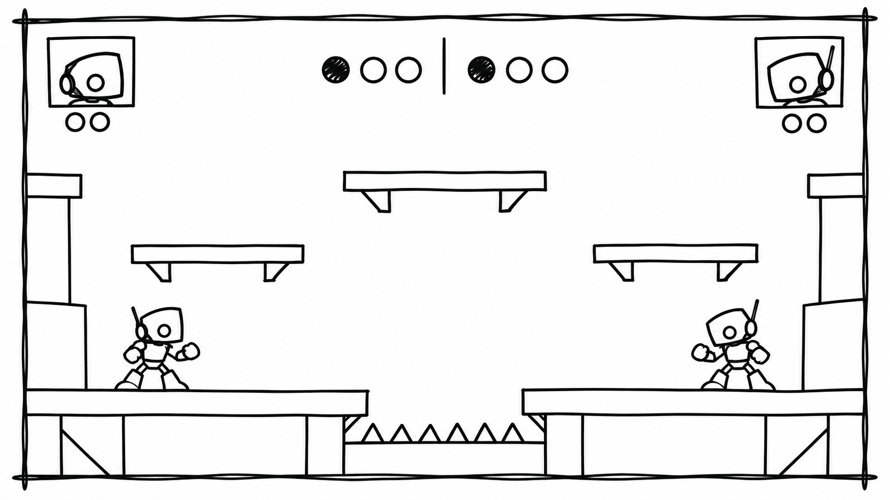
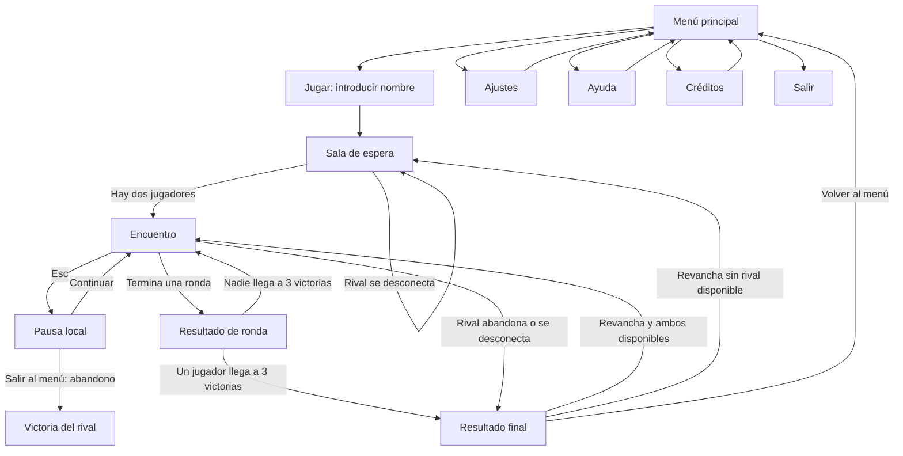

# Ring Out — Documento de Diseño del Juego (GDD)

[← Volver al README](README.md)

**Grupo E**

## Índice

1. [Introducción](#1-introducción)
2. [Especificaciones básicas](#2-especificaciones-básicas)
3. [Jugabilidad](#3-jugabilidad)
4. [Narrativa](#4-narrativa)
5. [Imagen y diseño visual](#5-imagen-y-diseño-visual)
6. [Sonido](#6-sonido)
7. [Interfaz y diagrama de flujo](#7-interfaz-y-diagrama-de-flujo)
8. [Comunicación y marketing](#8-comunicación-y-marketing)
9. [Referencias](#9-referencias)

---

## 1. Introducción

### 1.1. Concepto del juego

**Ring Out** es un juego competitivo de acción y plataformas en 2D para dos jugadores conectados en tiempo real. Cada participante controla un robot dentro de una arena y debe utilizar el movimiento, los saltos y los ataques para empujar al rival fuera de la zona segura. No hay barras de vida ni se busca destruir al contrincante: la victoria depende de la posición, la precisión y el uso del escenario.

Cada encuentro se disputa al mejor de cinco rondas. Gana el encuentro quien consigue primero tres victorias de ronda. Las arenas presentan distintas distribuciones de plataformas y obstáculos, por lo que el jugador debe adaptar sus movimientos y ataques al terreno.

### 1.2. Propuesta de valor

Ring Out combina controles sencillos con enfrentamientos centrados en el momento del ataque, la distancia, el salto y el posicionamiento. Sus elementos diferenciales son:

- **Combate por desplazamiento:** los ataques empujan al rival en lugar de restarle vida.
- **Armas con características distintas:** modifican el alcance, la fuerza del empuje y el tiempo de recuperación del ataque.
- **Arenas variadas:** las plataformas, los huecos y los obstáculos cambian las posibilidades de movimiento y el riesgo de cada enfrentamiento.

La propuesta prioriza partidas directas, con margen para mejorar la lectura del rival y el dominio del escenario.

---

## 2. Especificaciones básicas

| Aspecto | Descripción |
| :--- | :--- |
| **Título** | Ring Out |
| **Género** | Acción competitiva y plataformas arcade |
| **Número de jugadores** | 2 jugadores por encuentro, conectados en red y en tiempo real |
| **Público objetivo** | Público general interesado en juegos competitivos sencillos y partidas breves |
| **Clasificación por edades** | PEGI 7 como estimación orientativa, no como clasificación oficial |
| **Plataforma** | Navegador web en ordenador, sin instalación |
| **Tecnología prevista** | Phaser 3 para el juego, con comunicación mediante REST y WebSocket |
| **Duración estimada** | Aproximadamente entre 2 y 5 minutos por encuentro; la duración real dependerá de los enfrentamientos |
| **Representación** | 2D, vista lateral |
| **Licencia** | Apache License 2.0 |

La clasificación por edades es orientativa y no representa una certificación oficial.

---

## 3. Jugabilidad

### 3.1. Objetivo del juego

El objetivo de cada jugador es sacar al robot rival de la arena mediante ataques y empujes. Una ronda termina cuando un robot cae por debajo del límite inferior del escenario o toca una zona de pinchos. El jugador que provoca la derrota del rival gana la ronda.

El encuentro termina cuando uno de los participantes consigue tres rondas ganadas. Si ambos robots cumplen una condición de derrota en el mismo instante, la ronda se repite sin conceder un punto. Si uno la cumple antes que el otro, pierde la ronda.

### 3.2. Controles

Cada participante juega desde su propio equipo. Los controles son los mismos para ambos jugadores:

| Acción | Control |
| :--- | :--- |
| Moverse a la izquierda | `A` |
| Moverse a la derecha | `D` |
| Saltar | `Espacio` |
| Atacar | Clic izquierdo del ratón |
| Abrir la pausa local | `Esc` |

El ataque se dirige hacia el lado al que mira el robot. La dirección queda fijada al iniciar el ataque, aunque el jugador cambie de orientación durante la animación. Es necesario soltar el botón del ratón y volver a pulsarlo para realizar otro ataque.

### 3.3. Mecánicas

#### 3.3.1. Movimiento, salto y combate

- **Movimiento horizontal:** el robot se desplaza a izquierda o derecha con respuesta directa al control. Al soltar la tecla, deja de aplicar movimiento horizontal voluntario.
- **Salto:** cada pulsación de `Espacio` inicia un salto. Mantener la tecla pulsada no genera saltos repetidos ni modifica la altura. La gravedad actúa durante el salto y la caída.
- **Control en el aire:** el jugador puede dirigir el movimiento horizontal mientras está en el aire. Puede atacar tanto en el suelo como durante un salto o una caída.
- **Ataque:** cada ataque tiene una zona de impacto delante del robot. Si el rival está dentro de esa zona cuando se resuelve el ataque, recibe un impulso horizontal. Si el ataque falla, también se aplica su tiempo de recuperación.
- **Empuje:** la fuerza depende del arma utilizada, no del punto concreto en el que impacta. El empuje no añade un impulso vertical. Si el robot afectado está en el aire, mantiene la influencia de su salto y de la gravedad, mientras cambia su movimiento horizontal.
- **Recuperación:** no se puede iniciar otro ataque hasta que termine la recuperación del anterior. Los clics realizados durante ese periodo se ignoran. Recibir un golpe no reinicia ni alarga la recuperación, y tampoco elimina el control del jugador.
- **Ataques simultáneos:** los dos jugadores pueden atacar a la vez. Si ambos ataques cumplen sus condiciones de impacto, los dos pueden resolverse.
- **Colisión entre jugadores:** los robots pueden atravesarse durante el movimiento normal. La interacción física entre ellos se produce mediante los ataques y sus empujes, no por una colisión corporal.

Los valores de velocidad, salto, alcance, fuerza y recuperación se ajustarán durante la implementación y las pruebas. En esta fase se definen relaciones, no cifras de balance aún no comprobadas.

#### 3.3.2. Armas y objetos

En cada arena aparecen dos armas en posiciones predeterminadas. La recogida es automática al entrar en contacto con el arma, incluso en el aire. Al recogerla, desaparece del escenario durante el resto de la ronda. Cada robot puede llevar una sola arma: si recoge otra, sustituye la anterior, que desaparece. No hay inventario ni acción manual para soltar armas.

| Arma | Fuerza de empuje | Alcance | Recuperación |
| :--- | :--- | :--- | :--- |
| Sin arma | Baja | Base | La más corta |
| Guanteletes | Baja | Corto | Baja |
| Espada | Media | Medio | Media-baja |
| Lanza | Media | Largo | Media-alta |
| Martillo | Alta | Corto-medio | La más larga |

La espada y la lanza tienen una fuerza aproximada similar. Los valores concretos se decidirán durante el ajuste de jugabilidad. Las armas no proporcionan habilidades especiales adicionales: sus diferencias se limitan a la fuerza, el alcance y la recuperación del ataque.

#### 3.3.3. Sistema de puntuación

No se utilizan puntos numéricos por golpe ni puntuación acumulada. Cada ronda ganada suma una victoria al marcador del jugador. El primero que alcanza tres victorias gana el encuentro. El marcador se conserva entre rondas, mientras que el estado de los robots, las armas y los obstáculos se reinicia al comenzar cada ronda.

### 3.4. Físicas y dificultad

- **Gravedad y salto:** el robot salta con una altura objetivo media y cae por efecto de la gravedad. Solo puede iniciar otro salto después de aterrizar sobre una plataforma.
- **Plataformas:** son unidireccionales. El robot puede atravesarlas al subir desde abajo y aterrizar sobre ellas al caer desde arriba. Tras aterrizar, puede saltar de nuevo inmediatamente.
- **Caídas:** el robot puede caminar fuera del borde de una plataforma. La derrota por caída se activa al cruzar el límite vertical definido para la arena, no en el instante en que abandona la plataforma.
- **Pinchos:** tocarlos provoca la derrota inmediata de la ronda.
- **Plataformas temporales:** aparecen y desaparecen siguiendo un ciclo automático. Antes de desaparecer muestran una señal visual de advertencia; permanecen ausentes durante un intervalo y después reaparecen.
- **Plataformas móviles:** se desplazan de forma continua y predecible entre dos posiciones, invierten la dirección al llegar a cada extremo y transportan al robot que se encuentre encima.
- **Dificultad:** no aumenta automáticamente con el número de ronda. La dificultad procede principalmente de la geometría de cada arena, los obstáculos y las decisiones de ambos jugadores. Las cinco arenas se seleccionan al azar sin repetir una arena hasta haber utilizado las cinco; un encuentro puede terminar antes de que se hayan usado todas.

La pausa afecta únicamente al jugador que la activa. Al pulsar `Esc`, su robot queda inmóvil, pero conserva su posición y puede ser golpeado, empujado o derrotado. El rival continúa jugando. No se concede invulnerabilidad. Para volver a jugar hay que seleccionar «Continuar»; salir al menú durante un encuentro cuenta como abandono y concede la victoria al rival.

Si un jugador se desconecta o abandona durante el encuentro, el participante que sigue conectado gana automáticamente. No se contempla reconexión a una partida en curso. Si la desconexión ocurre en la sala de espera, el otro jugador permanece esperando a un nuevo rival.

### 3.5. Escenario

El juego cuenta con cinco arenas de geometría claramente diferenciada. Las ubicaciones exactas de las plataformas y los obstáculos se concretarán durante el desarrollo, manteniendo las características generales siguientes:

1. **Arena de entrenamiento:** plataforma principal amplia, sin peligros especiales; sirve como escenario inicial sencillo.
2. **Pasarela:** zonas a distintas alturas unidas por pasos estrechos y huecos que requieren saltos.
3. **Zona de peligro:** plataformas a varias alturas y zonas de pinchos que obligan a vigilar el aterrizaje y la posición.
4. **Suelo inestable:** combinación de superficies fijas y plataformas temporales que exigen anticipar sus ciclos.
5. **Arena dinámica:** distribución más vertical y compleja, con plataformas móviles y rutas alternativas.

Cada arena dispone de dos armas en posiciones fijas. No todas las arenas tienen que incluir todos los tipos de obstáculo. Al comenzar una ronda, los robots aparecen en posiciones adaptadas a la geometría y orientados hacia el centro, procurando evitar una ventaja inicial injustificada. Las posiciones iniciales de los obstáculos y las armas se restauran en cada nueva ronda.

*Figura 1. Esquema de las arenas. Debe sustituirse por un mapa o una lámina con las cinco geometrías previstas.*

---

## 4. Narrativa

### 4.1. Historia

En un futuro en el que los combates entre robots se han convertido en un espectáculo deportivo popular, los competidores participan en torneos donde la victoria no depende de destruir al contrario, sino de demostrar control, precisión y capacidad para dominar la arena. El objetivo es empujar al rival fuera de la zona de combate y mantenerse dentro de ella.

El torneo ofrece prestigio y reconocimiento a quienes consiguen imponerse a sus rivales. Entre los participantes destacan Bolt, un veterano que quiere demostrar que la experiencia sigue siendo decisiva, y Rivet, un recién llegado que busca probar que la nueva generación puede superar a los competidores consagrados.

Ambos formaron parte del mismo equipo, pero acabaron separándose por sus distintas maneras de entender el combate. Su enfrentamiento en el torneo convierte la competición en una oportunidad para resolver esa rivalidad deportiva. La historia se presenta mediante la descripción del juego y de sus personajes; no se plantean escenas narrativas ni diálogos durante las partidas.

### 4.2. Personajes

*Figura 2. Boceto de los personajes. Se puede variar el color.*

#### Bolt
- **Origen:** competidor veterano del circuito de torneos.
- **Personalidad:** disciplinado, sereno y calculador.
- **Motivación:** defender su reputación y demostrar que la experiencia continúa siendo una ventaja.
- **Trasfondo:** formó parte del mismo equipo que Rivet. La separación entre ambos surgió de sus distintas opiniones sobre la forma de competir.
- **Características jugables:** utiliza las mismas estadísticas y opciones de combate que Rivet. Su identidad se distingue visualmente por el color azul, no por una ventaja jugable.

#### Rivet
- **Origen:** nuevo competidor del torneo.
- **Personalidad:** impulsivo, enérgico y ambicioso.
- **Motivación:** ganarse el reconocimiento y demostrar que la nueva generación puede vencer a los veteranos.
- **Trasfondo:** compartió equipo con Bolt antes de que sus diferentes perspectivas sobre el combate los llevaran por caminos separados.
- **Características jugables:** utiliza las mismas estadísticas y opciones de combate que Bolt. Su identidad se distingue visualmente por el color rojo, no por una ventaja jugable.

Los dos robots comparten el mismo modelo base y las mismas capacidades. La diferencia entre ellos es narrativa y visual, para que la elección del personaje no afecte al equilibrio competitivo.

---

## 5. Imagen y diseño visual

### 5.1. Logotipo

*Figura 3. Logotipo de Ring Out. Se plantea una tipografía gruesa y dinámica que transmita energía y competición.*

El logotipo debe ser legible en tamaños pequeños y mantener el contraste con los fondos oscuros. El recurso gráfico definitivo se incorporará a la carpeta `img`.

### 5.2. Estilo visual

Ring Out utilizará un estilo **cartoon 2D** con estética arcade. Los robots tendrán siluetas compactas y reconocibles, extremidades mecánicas sencillas y pocos detalles internos. Los escenarios representarán estructuras metálicas propias de una arena deportiva, sin decoración que dificulte distinguir plataformas, armas, peligros o personajes.

El estilo prioriza la claridad visual sobre el realismo. Las animaciones se centrarán en el movimiento, el salto, el ataque, el impacto y la derrota.

### 5.3. Uso de colores

*Figura 4. Paleta cromática propuesta para el juego.*

- **Azul intenso:** identifica a Bolt y al jugador asignado al color azul.
- **Rojo intenso:** identifica a Rivet y al jugador asignado al color rojo.
- **Fondos oscuros y tonos metálicos neutros:** forman la base de las arenas y evitan competir visualmente con los robots.
- **Acentos claros y de alto contraste:** destacan elementos de interfaz, armas y señales de peligro.

El servidor asignará los colores azul y rojo según la posición de cada participante en el encuentro. El color es una identificación visual y no modifica las capacidades del robot.

### 5.4. Aspectos técnicos: cámara y representación

- **Representación:** 2D, vista lateral.
- **Cámara:** fija, mostrando el escenario completo. No sigue individualmente a los robots.
- **Resolución base:** se concretará durante la implementación según las necesidades del navegador y la composición de las arenas.
- **Lectura visual:** los jugadores, las plataformas y los peligros deberán distinguirse con claridad incluso durante saltos, ataques y empujes.

### 5.5. Inspiración artística y cultural

La dirección artística combina la claridad arcade con la lectura lateral de los juegos de plataformas. La competición mecánica permite usar estructuras metálicas, señales de peligro y colores intensos.

Como referencias de diseño se estudiarán juegos de combate de plataformas y títulos arcade que prioricen el desplazamiento y la lectura rápida de la acción. Estas referencias servirán como orientación visual y de presentación, sin copiar personajes, escenarios, logotipos ni recursos gráficos. Las referencias concretas y sus enlaces se añadirán al cerrar el material visual utilizado.

### 5.6. Bocetos de personajes y pantallas

Los bocetos de Bolt, Rivet, el logotipo, la paleta y las pantallas se almacenarán en `img/`. Los recursos visuales que deben prepararse para completar esta sección son:

- Logotipo y paleta cromática.
- Bocetos de ambos robots.
- Bocetos del menú principal, sala de espera, partida, pausa, resultado de ronda, resultado final, ajustes, ayuda y créditos.
- Esquemas de las cinco arenas y sus principales plataformas y obstáculos.
- Una imagen promocional sencilla para presentar el concepto del juego.

Los bocetos documentan la propuesta, no una implementación ya realizada.

---

## 6. Sonido

### 6.1. Banda sonora

Se plantean dos pistas musicales en bucle: una más tranquila para el menú y otra más enérgica para los enfrentamientos. El cambio entre ambas será directo, sin transiciones elaboradas. No se contemplan voces.

| Pista | Escena | Estilo / ambiente | Fuente |
| :--- | :--- | :--- | :--- |
| Música de menú | Menú y pantallas secundarias | Ambiente electrónico relajado | Pendiente de seleccionar o crear |
| Música de partida | Encuentros | Ritmo electrónico enérgico y arcade | Pendiente de seleccionar o crear |

La fuente y la licencia de las pistas definitivas deberán documentarse antes de incluirlas en el juego.

### 6.2. Efectos de sonido

Los efectos serán breves y de estilo arcade, para reforzar acciones sin saturar la partida.

| Efecto | Momento de reproducción |
| :--- | :--- |
| Salto | Cuando el robot inicia un salto |
| Ataque | Cuando comienza un ataque |
| Impacto | Cuando un ataque golpea al rival |
| Recoger arma | Cuando un robot recoge un arma |
| Caída o derrota | Cuando se resuelve una derrota |
| Interfaz | Al activar botones o cambiar de pantalla |

El impacto combinará un efecto sonoro corto con una animación sencilla. Los controles de ajustes permitirán regular por separado el volumen de la música y el de los efectos.

---

## 7. Interfaz y diagrama de flujo

### 7.1. Pantallas

**Menú principal**

El menú principal ofrecerá las opciones **Jugar**, **Ajustes**, **Ayuda**, **Créditos** y **Salir**. La opción Jugar solicitará el nombre del participante y lo llevará a la sala de espera.

**Sala de espera**

La sala mostrará que se está buscando un rival y el número de participantes conectados (por ejemplo, 1/2). Cuando haya dos jugadores disponibles, el encuentro comenzará automáticamente. Si un rival se desconecta antes de empezar, el jugador restante seguirá esperando.

**Pantalla de juego (HUD)**

El HUD mostrará los nombres de ambos jugadores, sus colores y el marcador de rondas. La cámara fija permitirá ver la arena completa.

**Pausa**

La pausa es local y presenta dos opciones: **Continuar** y **Salir al menú**. El rival continúa jugando mientras el jugador que ha abierto el menú permanece inmóvil y puede recibir impactos o caer. Salir al menú durante un encuentro se considera abandono y concede la victoria al rival.

**Resultado de ronda**

Al terminar una ronda, se mostrarán el ganador y el marcador actualizado durante unos segundos. Después, el juego iniciará automáticamente la siguiente ronda o mostrará el resultado final si un jugador ha alcanzado tres victorias.

**Resultado final**

La pantalla final mostrará el ganador, los nombres de ambos participantes y el marcador definitivo. Ofrecerá **Revancha** y **Volver al menú**. La revancha permitirá disputar otro encuentro con el mismo rival si ambos siguen conectados y preparados; de lo contrario, el jugador permanecerá esperando a otro rival.

**Ajustes, ayuda y créditos**

- **Ajustes:** controles separados para el volumen de música y efectos de sonido.
- **Ayuda:** explicación del objetivo, controles, armas, peligros y reglas de victoria.
- **Créditos:** información de autoría y recursos utilizados.

El nombre no puede estar vacío ni contener solo espacios. No se ha definido una longitud máxima. Los nombres deben ser únicos entre participantes conectados, pero pueden reutilizarse tras una desconexión.

### 7.2. Diagrama de flujo

*Figura 9. Flujo general de navegación y de un encuentro.*

---

## 8. Comunicación y marketing

- **Público y mensaje clave:** público general interesado en juegos arcade competitivos. El mensaje central es que la posición y el momento del ataque importan más que acumular daño.
- **Material de presentación:** logotipo, descripción breve, bocetos de personajes, capturas o imágenes conceptuales y una explicación visual de las mecánicas.
- **Mensaje promocional:** presentar Ring Out como un enfrentamiento rápido de dos jugadores en el que cada empujón puede decidir la ronda.
- **Eslogan:** «Empuja. Resiste. Gana».
- **Canales:** la presentación del proyecto y sus materiales gráficos servirán para comunicar el concepto. No se define en esta fase una campaña comercial ni un calendario de publicación.

---

## 9. Referencias

Las referencias definitivas deben corresponder a materiales consultados y recursos utilizados. Se indicarán autoría, licencia y enlace para cada recurso externo.

- Phaser Studio. (s. f.). *Phaser Documentation*. https://docs.phaser.io/
- OpenJS Foundation. (s. f.). *Node.js documentation*. https://nodejs.org/docs/latest/api/
- MDN Web Docs. (s. f.). *WebSocket API*. https://developer.mozilla.org/en-US/docs/Web/API/WebSocket
- MDN Web Docs. (s. f.). *Using the Fetch API*. https://developer.mozilla.org/en-US/docs/Web/API/Fetch_API/Using_Fetch

**Recursos gráficos y sonoros:** se añadirán aquí los autores, las licencias y las URL de los recursos externos que se incorporen al proyecto. Los recursos propios se identificarán como tales.
