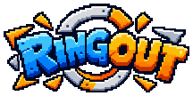

<p align="center">
  
</p>

# Ring Out

**Juegos en Red · Grado en Diseño y Desarrollo de Videojuegos · URJC · Curso 2026/27**  
**Grupo E**

## Descripción de la temática

*Ring Out* es un videojuego competitivo de acción y plataformas en 2D. Dos jugadores controlan a **Bolt** y **Rivet**, dos robots que luchan en una arena para empujar al rival fuera del escenario. No hay barras de vida: la victoria depende del posicionamiento, los saltos, el momento de atacar y el uso de las plataformas.

Las partidas se disputan **al mejor de cinco rondas**: gana quien consigue primero **tres victorias**. Durante los combates se pueden recoger armas que modifican la fuerza del empuje, el alcance y el tiempo de recuperación de los ataques.

**La fase 2 ofrece juego local para dos personas en el mismo ordenador.** El multijugador en red forma parte de las fases posteriores y todavía no está disponible. Actualmente se utilizan tres arenas: **Entrenamiento, Pasarela y Suelo inestable**. El [GDD](GDD.md) recoge también las funcionalidades y arenas previstas para la versión final.

El lema del juego es **«Empuja. Resiste. Gana.»**

## Equipo de desarrollo

| Nombre y apellidos | Correo URJC | GitHub |
| :--- | :--- | :--- |
| Daniel del Barrio Vallejo | d.delbarrio.2024@alumnos.urjc.es | `bXrriodXn` |
| Roberto Bueno Bascuñana | r.bueno.2024@alumnos.urjc.es | `betobubas` |
| Manuel Vadillo Esteban | m.vadillo.2024@alumnos.urjc.es | `manue279` |
| Lucía Muñoz Mota | l.munozm.2024@alumnos.urjc.es | `luciia99` |

**Repositorio:** [Ring-Out en GitHub](https://github.com/bXrriodXn/Ring-Out)  
**Licencia del código:** [Apache License 2.0](LICENSE)

---

## Fase 2 — Desarrollo del juego en local

En esta fase se desarrolla la versión local jugable, como base para incorporar posteriormente la comunicación cliente-servidor. Las siguientes características corresponden a lo implementado y trabajado en la versión local; las funcionalidades previstas en el GDD no se consideran implementadas por el hecho de estar descritas allí.

### Funcionalidades del juego

- **Dos jugadores locales:** Bolt y Rivet comparten teclado, con controles independientes y configurables.
- **Movimiento y combate:** desplazamiento horizontal, saltos, ataques, empujes y colisiones con las plataformas.
- **Salto continuo:** mantener la tecla de salto permite volver a saltar al aterrizar.
- **Armas:** guanteletes, espada, lanza y martillo, con diferencias de fuerza, alcance y recuperación. En cada ronda aparecen dos tipos aleatorios distintos en posiciones fijas, y cada robot puede recoger un arma hasta la siguiente ronda.
- **Arenas:** Entrenamiento, Pasarela y Suelo inestable, con distribuciones de plataformas y obstáculos propias. La Pasarela incluye pinchos.
- **Rondas y puntuación:** partida al mejor de cinco, victoria al obtener tres rondas y repetición de ronda en caso de empate.
- **Cuenta atrás inicial:** tres segundos antes de activar la primera ronda.
- **Pausa:** cualquiera de los dos jugadores puede pausar; solo quien inició la pausa puede reanudar. También se puede volver al menú.
- **Interfaz:** marcadores visuales de las rondas ganadas, iconos del arma equipada y pantalla de resultados con opción de revancha.
- **Presentación y efectos:** animaciones de robots, fondos de arenas, partículas de salto y círculos pulsantes en los puntos de aparición de armas.

### Menús y escenas

- **Menú principal:** acceso a partida local, ajustes, ayuda y créditos. La opción online está reservada para una fase posterior.
- **Ajustes:** volumen general y configuración de controles.
- **Ayuda:** instrucciones para comprender la mecánica y jugar.
- **Créditos:** información del juego y del equipo.
- **Partida, pausa y resultados:** escenas diferenciadas con navegación entre ellas.

### Música y efectos de sonido

- Música de menú y música de combate diferentes.
- Efecto de clic para los botones de selección.
- Efecto de clic más grave para los botones **Volver**, editado a partir del clic original.
- Recurso de sonido de impacto preparado; está pendiente de confirmar su reproducción en el momento de recibir un golpe.
- Control de volumen general desde Ajustes.

### Controles

El juego local está pensado para **dos personas con un teclado**. Cada jugador dispone de teclas para moverse, saltar, atacar y pausar. Las asignaciones pueden consultarse en **Ayuda** y modificarse en **Ajustes**.

El ratón se utiliza para seleccionar opciones y botones de los menús. Solo el jugador que ha pausado puede reanudar la partida mediante su tecla de pausa.

### Requisitos y ejecución

- Ordenador con un navegador web moderno.
- [Node.js](https://nodejs.org/) y npm para iniciar el servidor local de desarrollo.
- Conexión a Internet para cargar Phaser desde el CDN, si se utiliza la configuración actual mediante scripts externos.

Desde la carpeta raíz del proyecto:

```bash
npm install
npm run dev
```

Abrir en el navegador la dirección indicada por el servidor local (en nuestra configuración de desarrollo, `http://localhost:3000`). El combate de la fase 2 funciona **sin conexión a un servidor de juego**: ambos participantes juegan en el mismo ordenador.

### Organización del código

El proyecto está desarrollado en **JavaScript y Phaser 3**, con escenas y sistemas separados para facilitar su mantenimiento:

- `index.html`: entrada del juego.
- `src/main.js`: configuración de Phaser.
- `src/scenes/`: menú, partida, pausa, resultados, ajustes, ayuda, créditos y carga de recursos.
- `src/entities/Robot.js`: lógica de movimiento y combate de los personajes.
- `src/data/`: configuración de controles, armas y arenas.
- `src/animations/`: animaciones de los robots.
- `assets/` e `img/`: recursos gráficos y de audio.

### Alcance de esta fase

**Incluido:** partida local para dos jugadores y los sistemas de juego descritos arriba.

**Pendiente para las siguientes fases:** API REST, gestión de usuarios, conexiones con servidor y partidas online mediante WebSockets. La presencia de la opción Online en el menú no significa que el multijugador esté implementado.

---

## Recursos y atribuciones

### Música

La música del menú y de la partida se ha generado mediante [Suno AI](https://suno.com/).

### Efectos de sonido

- **Click:** sonido para selección de botones. [Fuente original](https://youtu.be/l9ZUHT0xMwQ).
- **Back:** versión editada del sonido Click (tono más grave y volumen reducido) para botones de volver. [Fuente original](https://youtu.be/l9ZUHT0xMwQ).
- **Hit:** sonido de impacto recortado para eliminar silencios. [Fuente original](https://youtu.be/xxO0hjt7_60).

La licencia Apache 2.0 indicada arriba se refiere al **código fuente del proyecto**, no concede por sí sola derechos sobre los recursos de terceros. Deben respetarse las licencias y condiciones aplicables a cada recurso, incluidas las de Suno.

---

## Documento de diseño del juego

El documento de diseño completo se encuentra en **[GDD.md](GDD.md)**. Describe tanto las decisiones de diseño como funciones previstas para futuras fases; para conocer el estado de la implementación local, consultar el apartado **Fase 2** de este README.

Apartados principales:

- [Especificaciones básicas](GDD.md#2-especificaciones-básicas)
- [Jugabilidad](GDD.md#3-jugabilidad)
- [Narrativa](GDD.md#4-narrativa)
- [Imagen y diseño visual](GDD.md#5-imagen-y-diseño-visual)
- [Sonido](GDD.md#6-sonido)
- [Interfaz y diagrama de flujo](GDD.md#7-interfaz-y-diagrama-de-flujo)
- [Comunicación y marketing](GDD.md#8-comunicación-y-marketing)
- [Referencias](GDD.md#9-referencias)

---

## Fases del proyecto

| Fase | Contenido | Estado |
| :--- | :--- | :--- |
| Fase 1 | Equipo, temática y documento de diseño | Entregada |
| Fase 2 | Desarrollo del juego en local | Completada, pendiente de evaluación |
| Fase 3 | Implementación de la API REST | Pendiente |
| Fase 4 | Comunicación en tiempo real mediante WebSockets | Pendiente |

### Preparación de la entrega de fase 2

La versión de entrega se identificará en GitHub mediante el **tag `fase2`** y una **release** asociada, una vez confirmadas las pruebas finales. El archivo para Aula Virtual incluirá el código y los recursos necesarios, este README actualizado desde GitHub, `GDD.md`, el documento del grupo con integrantes y URL del repositorio, y la presentación de defensa.

El tag y la release no se consideran creados hasta que se publiquen efectivamente en GitHub.
